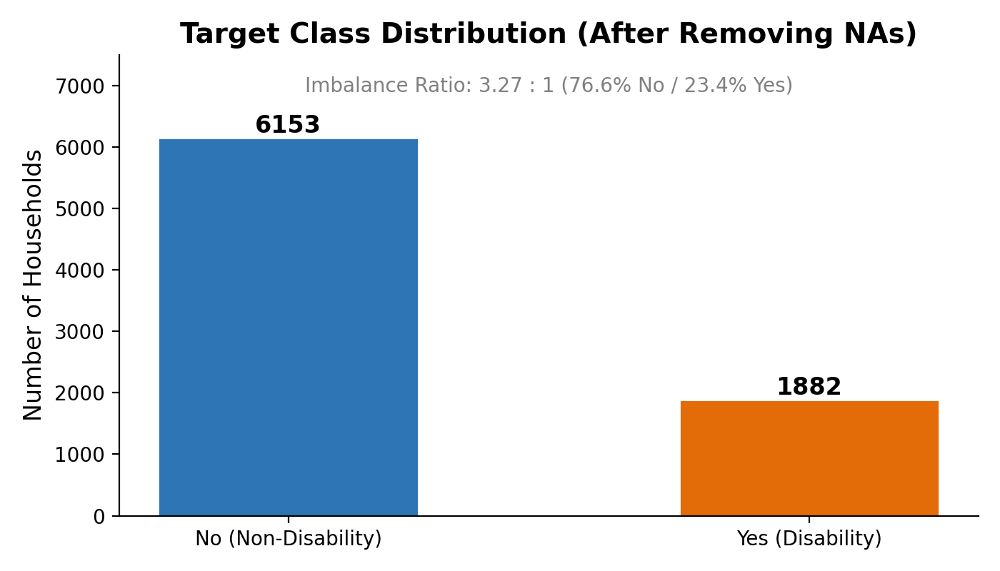
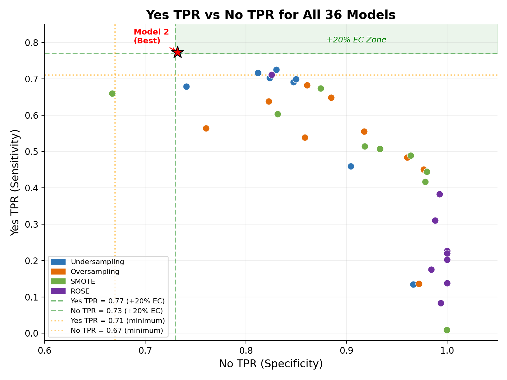
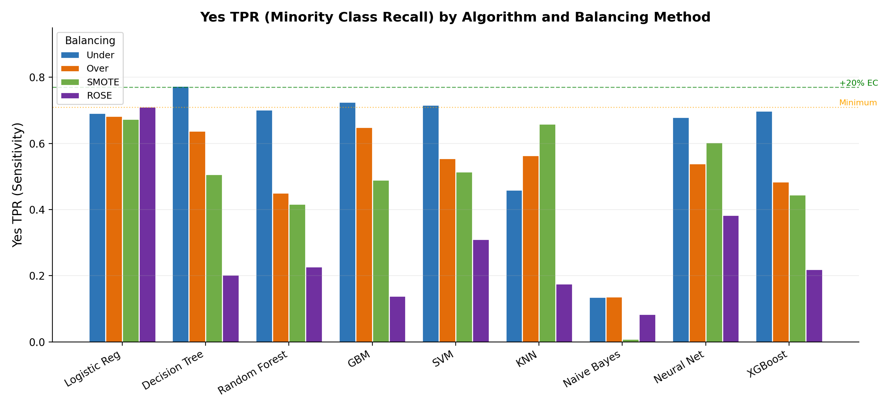
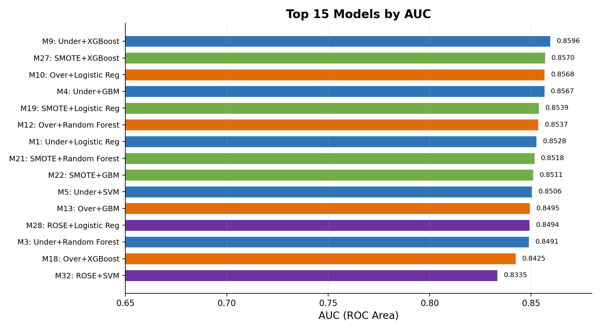
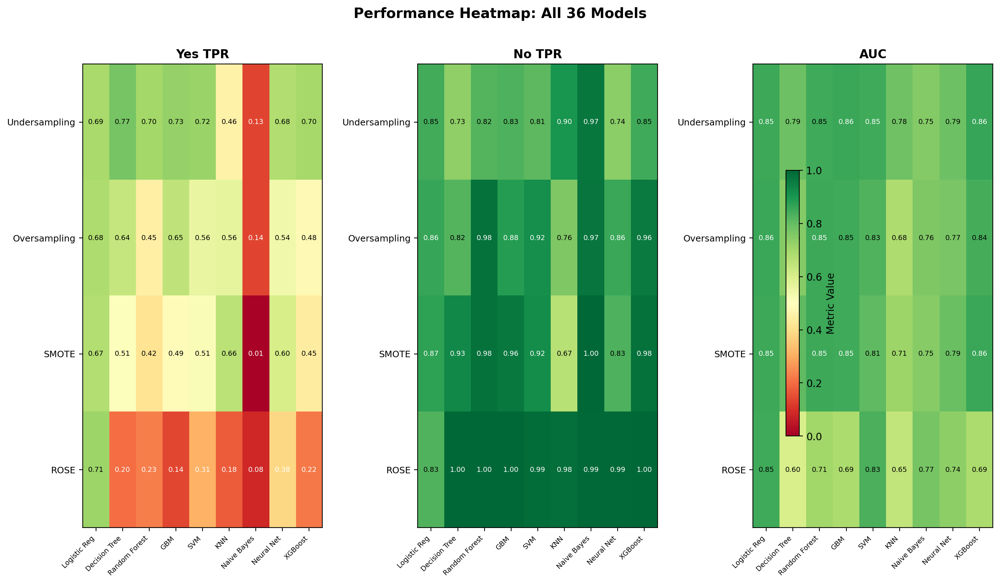
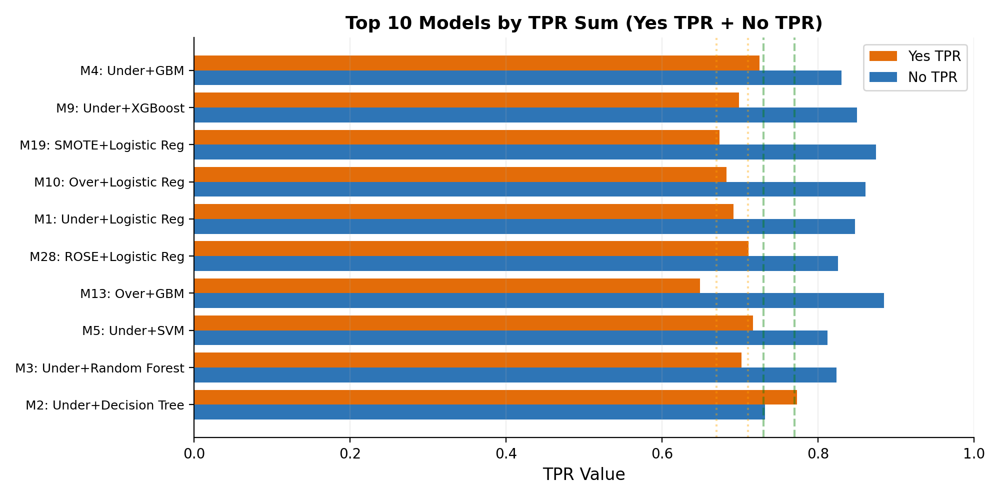

# CS699 Data Mining: Classification of Disability Status in U.S. Households

This project uses the **2023 American Housing Survey (AHS)** to classify whether a household includes a person with a disability. It compares **36 models: four class-balancing methods × nine classification algorithms**, with particular attention to detecting the minority `Yes` class.

The repository includes the R pipeline, input and prepared datasets, recorded experiment output, six figures, the final report, presentation slides, and presentation preparation materials.

## Main findings

| Selection objective | Model | Yes recall | No recall | AUC | Interpretation |
|---|---|---:|---:|---:|---|
| Course threshold priority | M2: Undersampling + Decision Tree | 0.7730 | 0.7322 | 0.7887 | Only recorded model meeting both highest-tier thresholds |
| Highest sum of class recalls | M4: Undersampling + GBM | 0.7252 | 0.8304 | 0.8567 | Best recorded balanced accuracy, approximately 0.7778 |
| Highest ROC AUC | M9: Undersampling + XGBoost | 0.6986 | 0.8499 | 0.8596 | Best recorded ranking performance across thresholds |

The selected decision tree detects **436 of 564 Yes households**, missing 128. It correctly identifies 1,351 of 1,845 No households and produces 494 false positives. Its selection reflects the course's class-recall requirements; the metrics support different winners for other objectives.

All numerical results below describe the **existing recorded experiment**, primarily [output_log4.txt](output_log4.txt), with supporting evidence in the [final report](Cheng_HoMan_Peng_Weitao_Report.pdf) and chart-generation data. Models were not retrained for this documentation update.

## Detailed results and deliverables

- [Complete 36-model comparison and all confusion matrices](docs/RESULTS.md)
- [Machine-readable model comparison CSV](results/model_comparison.csv)
- [Final report (PDF)](Cheng_HoMan_Peng_Weitao_Report.pdf) · [Word version](Cheng_HoMan_Peng_Weitao_Report.docx)
- [Presentation slides](Cheng_HoMan_Peng_Weitao_Slides.pptx)
- [Project overview (PDF)](Project_Overview.pdf)
- [Presentation script](Presentation_Script.md) · [Q&A preparation](QA_Preparation.md)
- [AHS data dictionary](AHS_Dictionary_2023.pdf)

## Dataset and prediction target

`Class = Yes` indicates a household with a person with a disability; `Class = No` indicates the other class. The unit is the household rather than an individual medical diagnosis.

| Stage / split | Rows | No | Yes | Features excluding target |
|---|---:|---:|---:|---:|
| Original input | 9,241 | — | — | 144, including identifier |
| After removing missing/empty targets and CONTROL | 8,035 | 6,153 | 1,882 | 143 |
| After preprocessing | 8,035 | 6,153 | 1,882 | 118 |
| Stratified training split | 5,626 | 4,308 | 1,318 | 118 before correlation filtering |
| Stratified test split | 2,409 | 1,845 | 564 | 118 before correlation filtering |

The cleaned class distribution is **76.58% No / 23.42% Yes**, approximately **3.27:1**. Always predicting No would achieve approximately 76.6% accuracy while detecting zero Yes households, which explains the emphasis on class-specific recall.



## Processing and experimental workflow

```text
project_data.csv
  → remove missing targets and CONTROL identifier
  → convert feature columns to numeric
  → median imputation
  → constant / near-zero variance removal
  → winsorize continuous features; remove newly constant columns
  → center and scale
  → stratified 70/30 train/test split
  → four training-set balancing methods
  → correlation filtering for each balanced dataset
  → nine algorithms per dataset, with five-fold CV
  → predictions and probabilities on the same 2,409 test records
  → class-wise metrics, comparison and course-threshold selection
```

### Preprocessing details

1. Remove 1,206 records with missing/empty targets. Remove `CONTROL`, the record identifier.
2. Convert the remaining predictors to numeric. The recorded run has missing values in 62 of 143 features; `LOTSIZE` has the highest missing rate at 26.98%.
3. Impute missing predictor values with column medians; the recorded run leaves no missing values.
4. Remove constant and near-constant features with a lenient `nearZeroVar` frequency cutoff of 99:1. This removes 16 features and retains 127.
5. Apply IQR winsorization to the 25 features having more than 10 unique values, capping at Q1 − 1.5 × IQR and Q3 + 1.5 × IQR. Low-cardinality predictors are excluded from this step.
6. Remove nine features that become constant after winsorization, leaving 118 predictors. Center and scale the remaining features.
7. Split using `createDataPartition` and seed 699. The three prepared CSVs are included for inspection.

The report emphasizes preserving low-variance disability-related predictors such as `HHSEE`, `HHMEMRY`, `HHCARE`, and `HHERRND`. The README reports that design choice without treating it as proof of generalization to new populations.

### Balancing and feature selection

Balancing is applied to the training partition. The original test class distribution is retained.

| Method | Mechanism | Training rows | No / Yes | Final predictors |
|---|---|---:|---|---:|
| Random undersampling | Remove majority-class examples | 2,636 | 1,318 / 1,318 | 108 |
| Random oversampling | Duplicate minority-class examples | 8,616 | 4,308 / 4,308 | 108 |
| SMOTE | Neighbor interpolation, K = 5 | 8,262 | 4,308 / 3,954 | 108 |
| ROSE | Density-based synthetic sampling | 5,626 | 2,814 / 2,812 | 118 |

Each balanced dataset is filtered with `caret::findCorrelation`, cutoff 0.85. Ten correlated predictors are removed for undersampling, oversampling and SMOTE; none are removed for ROSE. Test columns are matched to the selected training columns. This is predictor-to-predictor correlation filtering; the implementation does not rank predictors by their correlation with the target.

## Algorithms and tuning

The main analysis uses R 4.5.2 according to the report. Most models use `caret::train` with five-fold cross-validation and class probabilities. The current caret configuration leaves the default classification selection metric (accuracy); the custom XGBoost wrapper explicitly selects by mean CV AUC.

| Algorithm | Implementation | Search configuration |
|---|---|---|
| Logistic regression | `glm`, binomial family | No hyperparameter grid |
| Decision tree | `rpart` | cp: 0.001, 0.005, 0.01, 0.02, 0.05 |
| Random forest | `rf` / `randomForest` | `tuneLength = 5` for mtry |
| Gradient boosting | `gbm` | Trees: 100/200/300; depth: 3/5; shrinkage: 0.01/0.1; minimum node size: 10 |
| Radial SVM | `svmRadial` / `kernlab` | `tuneLength = 5` |
| K-nearest neighbors | `knn` | k: 3, 5, 7, 9, 11, 15 |
| Naive Bayes | `naive_bayes` | Laplace: 0/1; kernel: false/true; adjust: 1 |
| Neural network | `nnet` | Hidden units: 5/10/15; decay: 0.001/0.01/0.1; MaxNWts: 10,000 |
| XGBoost | Direct `xgboost` API | Depth: 3/4/6/8; eta: 0.01/0.05/0.1/0.3; rounds: 100/200/300 |

XGBoost fixes column and row subsampling at 0.8 and minimum child weight at 1. Its manual five-fold CV wrapper handles the project's reported incompatibility between xgboost 3.x and caret's `xgbTree`. XGBoost uses a fixed 0.5 probability threshold; caret models use their default class predictions. No separate threshold search is implemented.

The logs format XGBoost eta with one decimal place, so a printed `eta=0.0` can represent a small nonzero grid value. It should not be interpreted as evidence that training used a zero learning rate. The selected decision-tree cp is not printed in the supplied final output, so only its search grid is documented here.

## Evaluation metrics

Treating Yes as the positive class:

- **Yes TPR / sensitivity / recall** = TP / (TP + FN): proportion of Yes households detected.
- **No TPR / specificity** = TN / (TN + FP): proportion of No households correctly identified.
- **Yes precision** = TP / (TP + FP): proportion of predicted Yes households that are actually Yes.
- **F1** combines precision and recall; class-wise values help expose imbalance.
- **ROC AUC** evaluates score ranking across thresholds, rather than the one operating point used for the confusion matrix.
- **MCC and Cohen's kappa** provide complementary agreement measures.
- **TPR sum** = Yes TPR + No TPR. Balanced accuracy is half this sum.

The full report and raw log include class-specific false-positive rates, precision, recall, F-measure, ROC area, MCC, kappa and weighted averages. [The results appendix](docs/RESULTS.md) and [CSV](results/model_comparison.csv) collect the main comparative metrics and confusion-matrix counts for every model.

## Why the project selects Model 2

The code applies the following priority tiers, then ranks qualifying models by TPR sum within the first available tier:

| Priority | Course criterion | Yes recall | No recall |
|---|---|---:|---:|
| 1 | +20% extra-credit threshold | ≥ 0.77 | ≥ 0.73 |
| 2 | +10% extra-credit threshold | ≥ 0.74 | ≥ 0.70 |
| 3 | Minimum threshold | ≥ 0.71 | ≥ 0.67 |
| Fallback | Highest overall TPR sum | — | — |

These labels describe the project's threshold checks, not a verified course grade. **Model 2 is the only recorded model in the first tier.**

### Selected model: Undersampling + Decision Tree

| Actual / Predicted | No | Yes |
|---|---:|---:|
| No | 1,351 | 494 |
| Yes | 128 | 436 |

| Metric | Recorded value |
|---|---:|
| Yes recall | 0.7730 |
| No recall | 0.7322 |
| Yes precision | 0.4688 |
| Yes F1 | 0.5837 |
| No F1 | 0.8129 |
| ROC AUC | 0.7887 |
| MCC | 0.4395 |
| Kappa | 0.4124 |
| TPR sum | 1.5053 |
| Accuracy | 0.7418 |

This operating point favors Yes detection: it finds 77.30% of Yes households, but 53.12% of its Yes predictions are false positives. Its accuracy is below the majority-class baseline, illustrating why accuracy alone does not capture the course objective. The model uses 108 predictors and 2,636 balanced training records.



## What the comparison shows

### Balancing changes the operating point

Undersampling produces higher Yes recall than the other three balancing methods for six of the nine algorithms in the recorded results. Logistic regression, KNN and Naive Bayes are the exceptions. This comes with lower No recall and discards majority-class training examples.

Oversampling and SMOTE frequently preserve strong No recall while giving up Yes recall. For example, SMOTE + XGBoost has AUC 0.8570 and No recall 0.9799, but Yes recall is only 0.4450 at the recorded operating point.

Several ROSE combinations show an especially strong majority-class bias on the original test distribution: ROSE + Decision Tree, Random Forest, GBM and XGBoost all have No recall 1.0000, while Yes recall ranges from 0.1383 to 0.2270. ROSE + Logistic Regression behaves differently, with Yes recall 0.7110 and No recall 0.8255. This demonstrates algorithm-specific behavior; the experiment alone does not establish the cause.



### Highest AUC and highest threshold performance are different objectives

Undersampling + XGBoost has the highest AUC (0.8596), while Undersampling + GBM has the highest TPR sum (1.5555, as printed from unrounded values). Neither meets the highest course tier because its Yes recall is below 0.77. A higher AUC does not guarantee that a fixed classification threshold meets both class-recall constraints.



### Model families have different strengths

Logistic regression is relatively stable across balancing methods: Yes recall ranges from 0.6738 to 0.7110, No recall from 0.8255 to 0.8743, and AUC from 0.8494 to 0.8568. Naive Bayes has low Yes recall throughout, from 0.0089 to 0.1365. These are observations from this experiment rather than universal rankings of the algorithms.





## Reproduce the analysis

From the project root, with R installed:

```powershell
Rscript .\project_code.R *> .\reproduction_log.txt
```

The script attempts to install missing packages. Required packages include `caret`, `e1071`, `randomForest`, `rpart`, `gbm`, `xgboost`, `nnet`, `kernlab`, `naivebayes`, `ROSE`, `smotefamily` and `pROC`. Installation needs network access and a suitable R library environment. The XGBoost grid alone has 48 candidates × five folds per balancing method, so a full run can be expensive.

Expected outputs include overwritten `preprocessed_data.csv`, `initial_train.csv` and `initial_test.csv`, plus console results for all 36 models and the final threshold-based selection. The new comparison CSV in this repository was extracted from the supplied final log; the original R script does not automatically export that summary CSV or trained model files.

Seed 699 is used throughout the main script. Exact reproduction can still depend on package versions, platform and numerical libraries; the repository has no `renv.lock`.

### Regenerate supporting artifacts

```powershell
npm ci
python .\generate_charts.py
node .\generate_report.js
node .\generate_slides.js
```

Python chart generation requires `matplotlib` and `numpy`. The Node package files declare `docx` and `pptxgenjs`. Supporting scripts contain original absolute Windows paths, which must be adapted to the local checkout before execution. The included report, slides and figures can be viewed without running these scripts. `time_test.R` contains a separate timing experiment; its output should not be substituted for the final 36-model run.

## Repository guide

| Path | Contents |
|---|---|
| `project_code.R` | Complete preprocessing, balancing, training, evaluation and selection pipeline |
| `project_data.csv` | Original project input |
| `preprocessed_data.csv` | 8,035 records, 118 predictors and target |
| `initial_train.csv`, `initial_test.csv` | Saved stratified splits |
| `output_log4.txt` | Final recorded full run used for this results summary |
| `output_log.txt`, `output_log2.txt`, `output_log3.txt` | Other recorded runs; retained as project history |
| `results/model_comparison.csv` | Extracted 36-model comparison and confusion counts |
| `docs/RESULTS.md` | Complete comparison table and individual confusion matrices |
| `charts/` | Six existing result figures |
| `generate_charts.py`, `generate_report.js`, `generate_slides.js` | Figure, report and slide generation |
| `create_overview_pdf.py`, `time_test.R` | Supporting overview generation and timing experiment |
| Report / slides / overview files | Final deliverables and editable counterparts |
| Presentation script / QA files | Speaking notes and discussion preparation |
| `AHS_Dictionary_2023.pdf` | Variable dictionary |
| Assignment documents | Original coursework reference material |

Installed `node_modules`, local `.claude` settings, environment files and caches are excluded by `.gitignore`.

## Interpretation and evaluation limitations

1. **Preprocessing precedes the train/test split.** Medians, winsorization bounds, variance filtering and scaling are derived from the full cleaned dataset. Test observations therefore influence preprocessing, so this is not a fully isolated end-to-end test evaluation. A stricter rerun would fit these transformations on training data and apply them to validation/test data.
2. **Balancing occurs before cross-validation.** Duplicated or synthetic examples can create dependence between CV folds. A stricter procedure would balance independently within each training fold and leave validation folds in their original distribution.
3. **The test set is used to compare 36 models and select the winner.** Its selected-model performance can be optimistic after selection. Nested validation or an additional untouched final test set would better assess generalization.
4. **Coding and target-related features need domain review.** Integer survey codes are treated numerically. Disability-related predictors may be closely connected to how the target is defined; the experiment does not establish how performance changes if these predictors are unavailable or excluded.
5. **One split and one survey-year dataset limit the conclusion.** The supplied analysis does not demonstrate population-weighted estimates, confidence intervals, external validation, or performance across demographic groups.
6. **The selected model reflects the course objective.** Higher Yes recall comes with many false positives and moderate precision. Deployment objectives would need separately specified costs and validation.

These notes describe the supplied implementation. This documentation update preserves the recorded results and does not claim that a corrected experimental design would produce the same scores.

